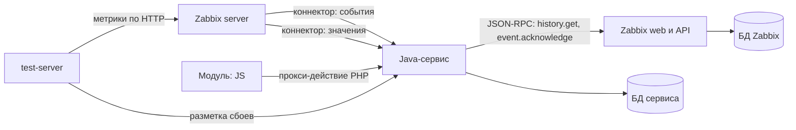

# zabbix-incident-advisor

Расширение Zabbix 7.0. Когда срабатывает триггер, оно показывает, с какого сервиса всё началось, какие метрики отклонились и какие строки логов это подтверждают. Разбор появляется в интерфейсе Zabbix и комментарием к самой проблеме.

Репозиторий — каркас для параллельной разработки. Инфраструктура готова: Zabbix, базы, доступы к API, коннекторы, модуль интерфейса, стенд со сбоями, CI со сквозной проверкой. Каждая идея из бэклога — отдельный модуль с заглушкой, и дописать в нём нужно только бизнес-логику.

## Быстрый старт

```bash
docker compose --profile stand up -d --build
```

Через 2–3 минуты:

| Что | Где |
|---|---|
| Zabbix | http://localhost:8070 — Admin / zabbix → **Monitoring → Incident advisor** |
| Панель сбоев стенда | http://localhost:8090 |
| API сервиса | http://localhost:8095, заголовок `X-Advisor-Token: dev-ui-token` |
| БД сервиса | `localhost:5433`, advisor / advisor |

Чтобы проверить разбор: на панели стенда включите, например, `ERRORS_5XX` на `database`. Через минуту-две в Zabbix откроются проблемы, а в Incident advisor появятся их разборы.

Без стенда — `docker compose up -d --build`. С локальной LLM:

```bash
ADVISOR_LLM_PROVIDER=openai docker compose --profile stand --profile ollama up -d --build
```

## Как это устроено



1. Срабатывает триггер — Zabbix отправляет событие **коннектором** на `/zabbix/connector/events`.
2. Сервис создаёт инцидент и через `ADVISOR_ANALYSIS_DELAY` (по умолчанию 60 с) запускает разбор.
3. **Конвейер** (`AnalysisService`): карта связей → история метрик и логов соседей из Zabbix API → отклонения → доказательства из логов → подозреваемые → объяснение.
4. Результат сохраняется в БД сервиса и уходит **комментарием к проблеме** в Zabbix. Если политика решит, что проблема — симптом другой, она будет помечена в Zabbix.
5. **Модуль интерфейса** показывает список и карточку инцидента. JS ходит в сервис через PHP-действие модуля: так работают сессия, права и CSRF Zabbix.
6. **test-server** присылает разметку каждого сбоя, и сервис считает, насколько точно разбор называет источник.

## Где писать бизнес-логику

Каждый модуль `service/analysis-*` зависит только от `domain`: он получает данные через аргументы и возвращает результат. Zabbix, БД и HTTP ему не нужны.

| Модуль | Интерфейс | Идея | Сейчас | Ответственный |
|---|---|---|---|---|
| `analysis-graph` | `ServiceGraphProvider` | 6. Карта связей | связи из тега хоста `depends_on` | |
| `analysis-metrics` | `MetricDeviationDetector` | 1. Отклонения метрик | правило трёх сигм — образец | |
| `analysis-logs` | `LogEvidenceExtractor` | 2. Доказательства из логов | заглушка | |
| `analysis-ranking` | `SuspectRanker` | 1. Кто первопричина | кто отклонился раньше — образец | |
| `analysis-ranking` | `CauseSymptomPolicy` | 8. Причина и симптомы | заглушка | |
| `analysis-explain` | `ExplanationWriter` | 3. Объяснение | шаблон, при включённой LLM — пересказ | |
| `analysis-evaluation` | `QualityEvaluator` | 7. Точность на стенде | совпадение по времени — образец | |
| `analysis-stream` | `ValueStreamProcessor` | 11, 18, 22. Поток значений | заглушка | |
| `zabbix-module` | JS-страница | 5. Карточка инцидента | список, карточка, таймлайн, оценка | |

Как взять задачу:
1. Ветка `feature/<номер>-<кратко>`.
2. Пишете класс в своём модуле, реализующий его интерфейс. Заглушку можно оставить рядом.
3. Переключаете реализацию **одной строкой** в `service/app/.../config/BusinessLogicConfig.java`.
4. Тестируете модуль без Spring — на готовых данных, как в `AnalysisServiceTest`.
5. PR. CI собирает сервис, прогоняет тесты и сквозную проверку на живом Zabbix.

Что доступно бизнес-логике:
- `IncidentContext` — инцидент, окно разбора, карта связей, сервисы в разборе, история метрик и логов по ним;
- `ZabbixWriter` — записать значение в Zabbix (`history.push`), комментарий, отметку симптома, создать или изменить триггер;
- `LlmClient` — вызвать модель. Маскирование и журнал уже встроены: передайте в `sensitive` имена хостов, и они не уйдут наружу.

Подробнее о модели данных и правилах — в [docs/development.md](docs/development.md).

## Структура

```
compose.yaml                 всё окружение
service/                     Java 21, Spring Boot 3.5, Gradle
  zabbix-client/             типизированный клиент Zabbix API 7.0 — готов
  domain/                    модель и интерфейсы бизнес-логики — готов
  llm/                       LLM: заглушка, OpenAI-совместимый API, маскирование, журнал — готов
  analysis-*/                бизнес-логика — заглушки и образцы
  app/                       конвейер, приём коннектора, БД, REST — готов
zabbix-module/incident-advisor/  модуль интерфейса Zabbix: JS + тонкий PHP
infra/setup/                 настройка Zabbix через API и сквозной тест
docs/                        разработка, точки расширения Zabbix
```

## Настройки сервиса

| Переменная | По умолчанию | Что задаёт |
|---|---|---|
| `ADVISOR_ANALYSIS_DELAY` | `60s` | через сколько после начала проблемы разбирать |
| `ADVISOR_ANALYSIS_LOOKBACK` | `15m` | сколько истории до начала брать в разбор |
| `ADVISOR_ANALYSIS_GRAPH_DEPTH` | `2` | насколько далеко по карте связей брать соседей |
| `ADVISOR_ZABBIX_COMMENT` | `true` | писать ли разбор комментарием к проблеме |
| `ADVISOR_LLM_PROVIDER` | `stub` | `stub` — без модели; `openai` — OpenAI-совместимый API |
| `ADVISOR_LLM_BASE_URL` | `http://ollama:11434/v1` | адрес API модели |
| `ADVISOR_LLM_MODEL` | `qwen2.5:3b` | модель |
| `ADVISOR_LLM_API_KEY` | — | ключ, если нужен |
| `ADVISOR_UI_TOKEN` | `dev-ui-token` | секрет между модулем интерфейса и сервисом |
| `ADVISOR_CONNECTOR_TOKEN` | `dev-connector-token` | токен, с которым приходит коннектор Zabbix |

## API сервиса

| Метод | Путь | Кто вызывает |
|---|---|---|
| POST | `/zabbix/connector/events` | коннектор Zabbix: события |
| POST | `/zabbix/connector/values` | коннектор Zabbix: значения элементов с тегом `advisor` |
| GET | `/api/incidents`, `/api/incidents/{id}` | модуль интерфейса |
| POST | `/api/incidents/{id}/reanalyze` | модуль: разобрать заново |
| POST | `/api/incidents/{id}/feedback` | модуль: «разбор верный / неверный» |
| GET | `/api/evaluation?scenarioId=` | точность на размеченных сбоях |
| GET | `/api/info` | состояние: Zabbix, LLM |
| POST | `/api/v1/labels` | test-server: разметка сбоя |

## Проверки

```bash
cd service && ./gradlew build          # сборка, юнит-тесты, интеграционный тест с PostgreSQL (нужен Docker)
python3 infra/setup/e2e_test.py        # на поднятом compose с --profile stand: вся цепочка
```

В CI работают оба шага. Второй поднимает всё окружение, включает сбой на стенде и проверяет, что разбор появился в сервисе, в Zabbix и в отчёте о точности.

## Сбросить всё

```bash
docker compose --profile stand --profile ollama down -v
```
