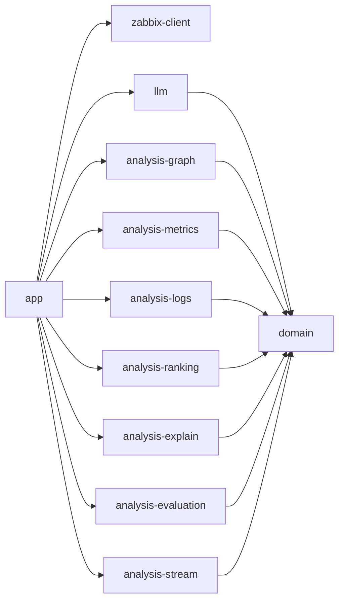

# Модули и контракты

Модули бизнес-логики общаются с остальной системой только через интерфейсы в `domain`, поэтому каждый может делать свой модуль параллельно, а вместо неготовой реализации стоит заглушка. Как писать и тестировать модуль — [development.md](../development.md).

## Репозиторий

| Папка | Что внутри | Состояние |
|---|---|---|
| `service/zabbix-client` | Типизированный клиент JSON-RPC API Zabbix 7.0 | готов |
| `service/domain` | Модель (инцидент, контекст, отклонение, подозреваемый, разметка) и интерфейсы бизнес-логики. Без фреймворков | готов |
| `service/llm` | LLM: заглушка, OpenAI-совместимый клиент, маскирование, журнал | готов |
| `service/analysis-*` | Бизнес-логика — по модулю на идею | заглушки и образцы |
| `service/app` | Spring Boot: конвейер, приём коннектора, БД, REST, выбор реализаций | готов |
| `zabbix-module/incident-advisor` | Модуль интерфейса Zabbix: `manifest.json`, PHP-действия, JS | список и карточка |
| `infra/setup` | Настройка Zabbix через API, сквозной тест | готов |
| `compose.yaml` | Всё окружение: Zabbix, БД, сервис, стенд, Ollama | готов |

## Карта модулей

## Интерфейсы бизнес-логики

Пакет `ru.itmo.advisor.domain.port`. Реализация выбирается одной строкой в `app/.../config/BusinessLogicConfig.java`.

| Интерфейс | Что делает | Модуль | Сейчас | Требования | Задачи |
|---|---|---|---|---|---|
| `ServiceGraphProvider` | Карта связей по хостам Zabbix | `analysis-graph` | тег `depends_on` | FR-03 | [#14](https://github.com/ITMO-DWS-Green/zabbix-incident-advisor/issues/14) |
| `MetricDeviationDetector` | Отклонения метрик и момент их начала | `analysis-metrics` | три сигмы — образец | FR-05, FR-06 | [#8](https://github.com/ITMO-DWS-Green/zabbix-incident-advisor/issues/8) |
| `LogEvidenceExtractor` | Характерные строки логов | `analysis-logs` | заглушка | FR-06 | [#10](https://github.com/ITMO-DWS-Green/zabbix-incident-advisor/issues/10) |
| `SuspectRanker` | Ранжированный список подозреваемых | `analysis-ranking` | кто отклонился раньше — образец | FR-05 | [#9](https://github.com/ITMO-DWS-Green/zabbix-incident-advisor/issues/9) |
| `CauseSymptomPolicy` | Какую проблему считать причиной текущей | `analysis-ranking` | заглушка | FR-15 | [#16](https://github.com/ITMO-DWS-Green/zabbix-incident-advisor/issues/16) |
| `ExplanationWriter` | Объяснение для комментария и карточки | `analysis-explain` | шаблон, при LLM — пересказ | FR-07, FR-14 | [#11](https://github.com/ITMO-DWS-Green/zabbix-incident-advisor/issues/11) |
| `QualityEvaluator` | Сверка разборов с разметкой | `analysis-evaluation` | совпадение по времени — образец | FR-09, FR-10 | [#15](https://github.com/ITMO-DWS-Green/zabbix-incident-advisor/issues/15) |
| `ValueStreamProcessor` | Обработка потока значений из коннектора | `analysis-stream` | заглушка | FR-13 | [#19](https://github.com/ITMO-DWS-Green/zabbix-incident-advisor/issues/19), [#26](https://github.com/ITMO-DWS-Green/zabbix-incident-advisor/issues/26), [#30](https://github.com/ITMO-DWS-Green/zabbix-incident-advisor/issues/30) |
| `ZabbixWriter` | Запись в Zabbix: `history.push`, комментарий, симптом, триггер | `app` | готов | FR-07, FR-15 | — |
| `LlmClient` | Вызов модели с маскированием и журналом | `llm` | готов | FR-14 | [#12](https://github.com/ITMO-DWS-Green/zabbix-incident-advisor/issues/12) |

## Внешние контракты

| Откуда → куда | Путь | Формат | Защита |
|---|---|---|---|
| Коннектор Zabbix → сервис | `POST /zabbix/connector/events` | NDJSON событий, ответ 200 | Bearer `ADVISOR_CONNECTOR_TOKEN` |
| Коннектор Zabbix → сервис | `POST /zabbix/connector/values` | NDJSON значений элементов с тегом `advisor` | Bearer `ADVISOR_CONNECTOR_TOKEN` |
| test-server → сервис | `POST /api/v1/labels` | Разметка сбоя; контракт test-server не меняем | открыт внутри сети стенда |
| test-server → сервис | `POST /api/v1/telemetry` | Принимается и игнорируется; отключаем в [#39](https://github.com/ITMO-DWS-Green/zabbix-incident-advisor/issues/39) | открыт |
| Модуль → сервис | `GET /api/incidents`, `/api/incidents/{id}`, `POST /api/incidents/{id}/reanalyze`, `/feedback`, `GET /api/evaluation`, `/api/info` | JSON | заголовки `X-Advisor-Token`, `X-Advisor-User` |
| Сервис → Zabbix | `/api_jsonrpc.php` | JSON-RPC 2.0 | API-токен Zabbix |
| Сервис → LLM | `{base}/chat/completions` | OpenAI-совместимый | ключ `ADVISOR_LLM_API_KEY` |

## Таблицы БД сервиса

| Таблица | Что хранит |
|---|---|
| `incident` | Инцидент, статус разбора, результат разбора целиком (JSONB) |
| `feedback` | Оценки разбора инженерами |
| `fault_label` | Разметка сбоев стенда |
| `llm_audit` | Журнал запросов к LLM в замаскированном виде |

## Правила зависимостей
- `domain` ни от чего не зависит, кроме аннотаций Jackson.
- `analysis-*` и `llm` зависят только от `domain`. Собирает их `app`.
- Spring — только в `app`.
- Разметку читает только `analysis-evaluation`.
- Изменение `domain` — отдельный PR с предупреждением в чате команды: оно затрагивает всех.
