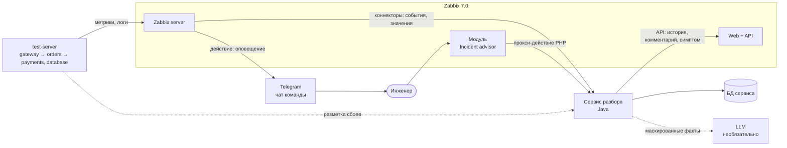
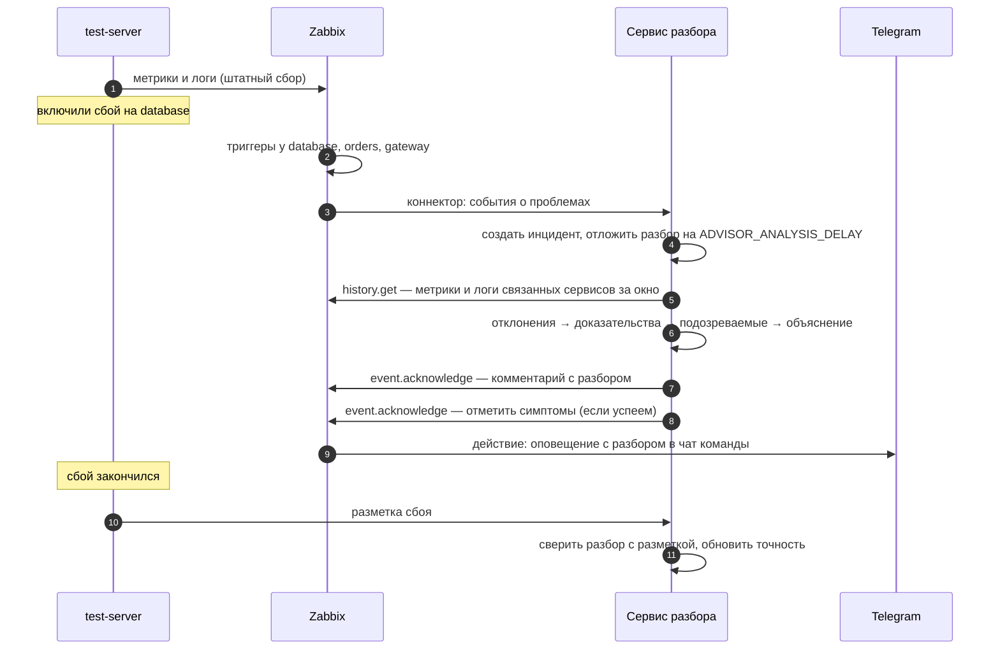

# Обзор архитектуры

Статус: **каркас реализован**, ревью командой — [#3](https://github.com/ITMO-DWS-Green/zabbix-incident-advisor/issues/3). Механизмы Zabbix — в [zabbix-integration.md](zabbix-integration.md), модули сервиса — в [modules.md](modules.md), как писать код — в [development.md](../development.md).

Расширение работает рядом с Zabbix 7.0 и не меняет его ядро. Zabbix собирает данные и открывает проблемы. Наш сервис получает события, сам ходит за историей, делает разбор и возвращает его в Zabbix; оповещение в Telegram отправляет действие Zabbix.

## Контекст

## Компоненты

| Компонент | Что делает | Где | Требования |
|---|---|---|---|
| test-server | Четыре сервиса со сбоями по кнопке; отдаёт метрики, пишет логи, присылает разметку | [репозиторий](https://github.com/ITMO-DWS-Green/test-server), профиль `stand` в `compose.yaml` | — |
| Zabbix server + agent 2 | Собирает метрики и логи, проверяет триггеры, открывает проблемы, отправляет коннекторы и оповещения | `compose.yaml` | — |
| Zabbix web + API | Интерфейс и JSON-RPC API | `compose.yaml` | — |
| Скрипт настройки | Хосты стенда, теги, триггеры, коннекторы, токен API, включение модуля | `infra/setup/setup.py` | NFR-02 |
| Сервис разбора | Принимает события и значения, строит инциденты, делает разбор, публикует результат, считает точность | `service/` | FR-01…FR-10 |
| БД сервиса | Инциденты, разборы, оценки инженеров, разметка, журнал LLM | PostgreSQL 16, `V1__init.sql` | NFR-07 |
| Модуль интерфейса | Список и карточка инцидентов внутри Zabbix | `zabbix-module/incident-advisor/` | FR-11, FR-12 |
| LLM | Пересказ найденных фактов; по умолчанию выключена | OpenAI-совместимый API, профиль `ollama` | FR-14, NFR-09 |
| Telegram | Групповые чаты команд | внешний | FR-08 |

## Главный сценарий

## Ключевые свойства
- **Не дублируем Zabbix.** Метрики, логи и триггеры живут в Zabbix; у нас только инциденты, разборы и оценки ([D-007](decisions.md)).
- **Разбор с задержкой.** Разбор начинается не сразу, а через минуту после начала проблемы: к этому времени срабатывают триггеры соседей и в истории есть точки после начала ([D-011](decisions.md)).
- **Бизнес-логика отдельно от инфраструктуры.** Модули `analysis-*` получают данные аргументами и не знают о Zabbix, БД и Spring — их можно писать параллельно и тестировать на готовых данных ([D-009](decisions.md)).
- **Честная оценка.** Разметка идёт от стенда напрямую в сервис и не участвует в разборе (NFR-10).
- **Два подхода на одних данных.** Базовый подход и наш разбор получают одни и те же инциденты — иначе сравнение нечестное.
- **Устойчивость.** Незавершённые разборы продолжаются после перезапуска; пропущенные события догоняем через `problem.get` ([#41](https://github.com/ITMO-DWS-Green/zabbix-incident-advisor/issues/41)).
- **Данные наружу не уходят без разрешения.** LLM по умолчанию выключена; если включена — только маскированные факты и журнал каждого запроса ([D-012](decisions.md)).

## Что не входит
Свой сбор и хранение метрик, свои триггеры, своё веб-приложение, агент — всё это даёт Zabbix. Каркас спринта 1 с генератором и приёмом телеметрии остался в [log-collector](https://github.com/ITMO-DWS-Green/log-collector) ([D-008](decisions.md)).
