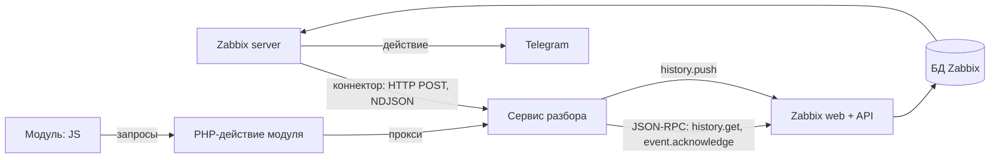

# Интеграция с Zabbix 7.0

Справка по механизмам, на которых стоит расширение, и по тому, как они настроены в этом репозитории. Источник — исходники Zabbix 7.0 (`github.com/zabbix/zabbix`, ветка `release/7.0`) и документация Zabbix 7.0. Песочница для экспериментов — [zabbix-sandbox](https://github.com/ITMO-DWS-Green/zabbix-sandbox).

## Взаимодействие



| Откуда → куда | Как | Что |
|---|---|---|
| Zabbix server → сервис | Коннектор, HTTP POST, построчный JSON | События о проблемах; значения элементов с тегом `advisor` |
| Сервис → API | JSON-RPC, `/api_jsonrpc.php`, токен API | История, конфигурация, проблемы; комментарии, симптомы, триггеры |
| Сервис → Zabbix | `history.push` | Свои значения в элементы Zabbix (например, оценка аномальности) |
| JS → PHP-действие → сервис | HTTP внутри Zabbix | Инциденты, разборы, оценки инженеров |
| Zabbix → Telegram | Действие и тип оповещения | Разбор из комментария — в чат команды |

## Что можно и что нельзя

| Можно | Нельзя (только на C внутри сервера) |
|---|---|
| Получать значения и события в реальном времени (коннектор) | Добавить свою функцию в выражения триггеров |
| Читать историю, тренды, всю конфигурацию (API) | Менять логику сервера |
| Комментировать проблемы, менять важность, отмечать симптомы | Перехватывать данные до записи в историю |
| Писать свои значения в элементы (`history.push`) | |
| Создавать и менять триггеры, элементы, теги, обслуживание, дашборды | |
| Добавлять страницы и виджеты в интерфейс (модули) | |

Модули сервера на C (`zbx_module_*`) загружаются до форка процессов сервера, поэтому для Java не подходят.

## Коннекторы → наш сервис
- Включаются на сервере: `StartConnectors` (по умолчанию 0). В `compose.yaml` — `ZBX_STARTCONNECTORS: 2`.
- Создаются в Administration → General → Connectors или `connector.create`. У нас их создаёт `infra/setup/setup.py`:

| Коннектор | `data_type` | Фильтр | Куда |
|---|---|---|---|
| incident-advisor: события | 1 — события | все | `/zabbix/connector/events` |
| incident-advisor: значения | 0 — значения | тег элемента `advisor` существует | `/zabbix/connector/values` |

- Авторизация — Bearer (`authtype: 5`), токен `ADVISOR_CONNECTOR_TOKEN`.
- Сервис должен ответить 200–204, иначе Zabbix повторяет отправку (`max_attempts` до 5), потом данные теряются — догоняем через API ([#41](https://github.com/ITMO-DWS-Green/zabbix-incident-advisor/issues/41)).

Событие о проблеме:
```json
{"clock":1761382800,"ns":0,"value":1,"eventid":42,"name":"gateway: доля 5xx выше 10%",
 "severity":3,"hosts":[{"host":"gateway","name":"gateway"}],"groups":["test-server"],
 "tags":[{"tag":"service","value":"gateway"}]}
```
Закрытие проблемы: `{"clock":…,"ns":…,"value":0,"eventid":43,"p_eventid":42}`.

Значение элемента:
```json
{"host":{"host":"gateway","name":"gateway"},"groups":["test-server"],
 "item_tags":[{"tag":"advisor","value":"stream"}],
 "itemid":45678,"name":"Доля 5xx","clock":1761382800,"ns":123456789,"value":0.12,"type":0}
```
`type` — тип значения: 0 — дробное, 1 — строка, 2 — лог, 3 — целое, 4 — текст.

## Наш сервис → API
JSON-RPC 2.0, `POST /api_jsonrpc.php`, заголовок `Authorization: Bearer <токен>`. Токен — постоянный API-токен (Users → API tokens). На стенде `setup.py` создаёт токен `incident-advisor` и кладёт его в общий том `/secrets/zabbix-api-token`.

```json
{"jsonrpc":"2.0","method":"history.get","id":1,
 "params":{"itemids":["45678"],"history":0,"time_from":1761296400,"sortfield":"clock","sortorder":"ASC"}}
```

| Задача | Методы | В `ZabbixApi` |
|---|---|---|
| Хосты, теги, элементы | `host.get`, `item.get` | `hosts`, `hostsByName`, `items` |
| История метрик и логов за окно | `history.get` (лог — `history: 2`), `trend.get` | `history`, `trends` |
| Существующие правила | `trigger.get` | `triggers` |
| Проблемы и события, догон пропусков | `problem.get`, `event.get` | `problems`, `events` |
| Комментарий с разбором | `event.acknowledge`, `action` 4 (сообщение) | `comment` |
| Отметка симптома | `event.acknowledge`, `action` 256 + `cause_eventid` (с 6.4) | `markSymptom` |
| Свои значения | `history.push` (с 7.0) | `push` |
| Создать или изменить правило | `trigger.create`, `trigger.update` | `createTrigger`, `updateTrigger` |
| Настройка | `connector.create`, `module.create`, `token.create` | в `setup.py` |

Все объекты API 7.0: action, alert, apiinfo, auditlog, authentication, autoregistration, configuration, connector, correlation, dashboard, dcheck, dhost, discoveryrule, drule, dservice, event, graph, graphitem, graphprototype, hanode, history, host, hostgroup, hostinterface, hostprototype, housekeeping, httptest, iconmap, image, item, itemprototype, maintenance, map, mediatype, mfa, module, problem, proxy, proxygroup, regexp, report, role, script, service, settings, sla, task, template, templatedashboard, templategroup, token, trend, trigger, triggerprototype, user, userdirectory, usergroup, usermacro, valuemap.

## Оповещение в Telegram
Через штатные средства Zabbix ([D-006](decisions.md), задача [#17](https://github.com/ITMO-DWS-Green/zabbix-incident-advisor/issues/17)):
1. Тип оповещения Telegram (встроенный вебхук) с токеном бота.
2. Пользователь Zabbix на каждую команду, в медиа — ID группового чата команды.
3. Действие по тегу `team`: операция обновления проблемы (наш комментарий) отправляет сообщение с текстом комментария.

## Модуль интерфейса
Лежит в `/usr/share/zabbix/modules/<имя>/`, включается в Administration → General → Modules или `module.create`. В `compose.yaml` папка `zabbix-module/incident-advisor` смонтирована в zabbix-web, модуль включает `setup.py`.

```
zabbix-module/incident-advisor/
  manifest.json            id, namespace, действия, подключение JS и CSS
  Module.php               пункт меню Monitoring → Incident advisor
  config.php               адрес сервиса и секрет
  actions/                 страница и прокси в сервис (GET и POST)
  views/                   PHP-шаблон, внутри только контейнер для JS
  assets/js/, assets/css/  весь интерфейс
```

- Контроллер наследует `CController` и реализует `checkInput`, `checkPermissions`, `doAction`.
- JS ходит в сервис через PHP-действие модуля: работают сессия и права пользователя Zabbix, не нужен CORS. POST защищён CSRF-токеном Zabbix.
- Прокси пропускает только пути `/api/…`, добавляет секрет `X-Advisor-Token` и имя пользователя `X-Advisor-User`.
- Вместо страницы можно сделать виджет дашборда (`"type": "widget"`, своя JS-логика в `js_class`) — [#33](https://github.com/ITMO-DWS-Green/zabbix-incident-advisor/issues/33).

## Тонкие места
- Изменения конфигурации через API (теги, триггеры) начинают работать после перечитывания кэша сервером — до минуты (`CacheUpdateFrequency`). На стенде `ZBX_CACHEUPDATEFREQUENCY=10`.
- Права: на стенде токен выдан Admin. Для боевого Zabbix — отдельный пользователь с чтением нужных групп хостов и правом комментировать проблемы ([#34](https://github.com/ITMO-DWS-Green/zabbix-incident-advisor/issues/34)).
- Элемент `testserver.status` показывает включённый сценарий. Он текстовый и без тега `component: logs`, поэтому в разбор не попадает (NFR-10).

## Источники
- Исходники Zabbix 7.0: `ui/include/classes/api/` (методы API), `src/zabbix_server/connector/`, `src/libs/zbxcachehistory/` (коннекторы), `ui/include/classes/core/CModule.php`, `ui/include/classes/mvc/CController.php` (модули) — [github.com/zabbix/zabbix](https://github.com/zabbix/zabbix), ветка release/7.0
- [Потоковая выгрузка во внешние системы](https://www.zabbix.com/documentation/7.0/en/manual/config/export/streaming)
- [Протокол экспорта в построчном JSON](https://www.zabbix.com/documentation/7.0/en/manual/appendix/protocols/real_time_export)
- [Модули интерфейса: manifest.json](https://www.zabbix.com/documentation/7.0/en/devel/modules/file_structure/manifest)
- [event.acknowledge](https://www.zabbix.com/documentation/7.0/en/manual/api/reference/event/acknowledge)
