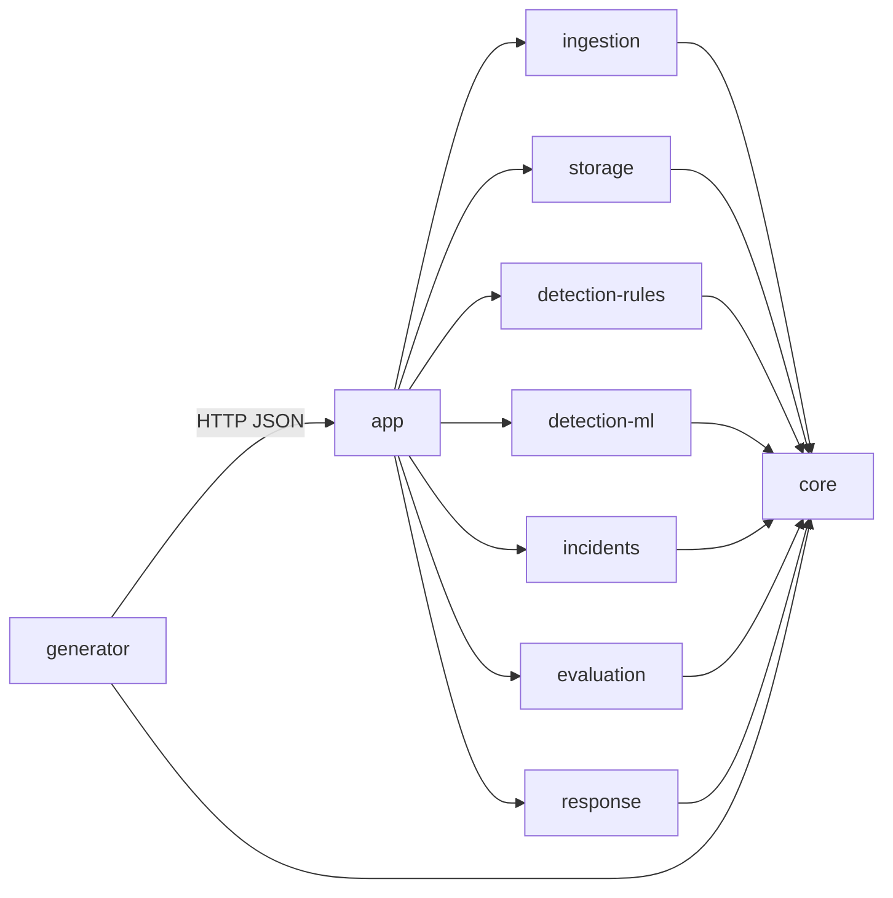

> Архив: версия из log-collector на конец спринта 1 (своя система мониторинга вместо расширения Zabbix). Ссылки внутри ведут на старую структуру. Актуальное — в [docs/](../../README.md).

# Модули и контракты

Каркас устроен так, чтобы каждый мог делать свой модуль, не дожидаясь остальных. Модули общаются только через **порты** — интерфейсы в `core`. Пока реализация не готова, вместо неё стоит заглушка, и система всё равно запускается от начала до конца.

## Карта модулей



| Модуль | Что внутри | Порт из core | Требования | Задачи |
|---|---|---|---|---|
| `core` | Единый формат данных и порты. Без фреймворков | — | FR-04 | #13 |
| `generator` | Отдельное приложение: имитирует сервисы, внедряет сбои, шлёт данные и разметку | — | FR-01, FR-02 | #8–#12 |
| `ingestion` | Приём потока и файла, нормализация | `TelemetrySink` (вызывает) | FR-03, FR-04 | #14–#16 |
| `storage` | Хранилища логов, метрик, разметки, инцидентов. Сейчас — в памяти | `TelemetryStore`, `LabelStore`, `IncidentStore` | — | #17 |
| `detection-rules` | Правила и статистические пороги | `Detector` | FR-05 | #18, #19 |
| `detection-ml` | ML-модель | `Detector` | FR-06 | #20, #21 |
| `incidents` | Объединение, ранжирование, объяснение | `IncidentCorrelator`, `SuspectRanker`, `IncidentExplainer` | FR-08–FR-10 | #22, #23, #27, #28 |
| `evaluation` | Показатели качества по разметке | `QualityEvaluator` | FR-07 | #25, #26 |
| `response` | Справочник «сервис — команда», чат инцидента | `TeamResolver`, `IncidentNotifier` | FR-11, FR-12 | #29–#32 |
| `app` | Spring Boot: конвейер, REST API, выбор реализаций | реализует `TelemetrySink` | FR-13 (бэкенд) | #33–#35 |

## Правила зависимостей
- Модуль-библиотека зависит **только от `core`**. Нужно что-то из другого модуля — значит, нужен порт в `core`.
- Spring — только в `app` и `generator`. Библиотеки остаются простыми классами: их легко тестировать без контекста.
- Реализации выбираются в одном месте — `app/.../config/ModulesConfig.java`. Готова новая реализация — меняешь одну строку.
- Меняешь порт или модель в `core` — это затрагивает всех: отдельный PR и предупреждение в чате.

## Конвейер
`app/.../pipeline/Pipeline.java` — только порядок шагов:

1. Пачка данных сохраняется в `TelemetryStore`.
2. Каждый `Detector` (правила и ML) получает **ту же** пачку и возвращает срабатывания.
3. Срабатывания идут в `IncidentCorrelator` своего подхода — у каждого подхода свои инциденты, иначе их не сравнить.
4. Новый или изменившийся инцидент: `SuspectRanker` → `IncidentExplainer` → `TeamResolver` по сервису-источнику → `IncidentStore`.
5. О новом инциденте — `IncidentNotifier` (чат).

Разметка сбоев в конвейер не попадает: её читает только `evaluation`.

## HTTP API
Базовый адрес — `http://localhost:8080/api/v1`. Время — ISO-8601 в UTC, сервис — строка.

| Метод | Путь | Что делает |
|---|---|---|
| POST | `/telemetry` | Принять пачку данных (поток) |
| POST | `/telemetry/file` | Загрузить файл JSON Lines (поле `file`), пока 501 |
| POST | `/labels` | Принять разметку сбоя от генератора |
| GET | `/services` | Список сервисов |
| GET | `/services/{service}/metrics/{metric}?from=&to=` | Значения метрики за интервал |
| GET | `/services/{service}/logs?from=&to=` | Записи лога за интервал |
| GET | `/incidents?approach=RULES\|ML` | Список инцидентов, новые первыми |
| GET | `/incidents/{id}` | Карточка инцидента |
| GET | `/scenarios` | Сценарии, по которым есть разметка |
| GET | `/scenarios/{id}/evaluation` | Показатели качества обоих подходов |

Пачка данных (`POST /telemetry`):
```json
{
  "logs": [
    {"timestamp": "2026-10-23T10:00:00Z", "service": "orders", "level": "ERROR",
     "message": "payment timeout", "traceId": "t-1", "attributes": {"endpoint": "/pay"}}
  ],
  "metrics": [
    {"timestamp": "2026-10-23T10:00:00Z", "service": "orders", "metric": "latency_ms", "value": 950.0}
  ]
}
```

Разметка (`POST /labels`):
```json
{"scenarioId": "s1", "faultId": "f1", "type": "LATENCY_SPIKE", "source": "database",
 "start": "2026-10-23T10:00:00Z", "end": "2026-10-23T10:05:00Z"}
```

Имена метрик — константы в `core/.../model/Metrics.java`; типы сбоев — `FaultType`.

## Формат файла для офлайн-анализа
JSON Lines: одна строка — одна запись лога или значение метрики, тип в поле `kind`.
```
{"kind": "log", "timestamp": "2026-10-23T10:00:00Z", "service": "orders", "level": "INFO", "message": "ok"}
{"kind": "metric", "timestamp": "2026-10-23T10:00:00Z", "service": "orders", "metric": "latency_ms", "value": 48.2}
```
Предложение для #15 — можно поменять, но до начала реализации.

## Запуск
```bash
./gradlew build                 # сборка и тесты
./gradlew :app:bootRun          # log-collector на :8080
./gradlew :generator:bootRun    # генератор, шлёт данные на :8080
docker compose up --build       # оба приложения в контейнерах
```

## Как взять модуль в работу
1. Возьми задачу с доски, создай ветку `feature/<номер>-<кратко>`.
2. Пиши реализацию в своём модуле; заглушку замени или оставь рядом и переключи в `ModulesConfig`.
3. Тестируй модуль без Spring — на поддельных реализациях портов, как в `PipelineTest`.
4. PR с `Closes #N`.

## Решения в каркасе (предложено, обсудить)
| Решение | Почему | Когда пересмотреть |
|---|---|---|
| Модульный монолит + отдельный генератор | Пять человек, один семестр: меньше инфраструктуры, а границы модулей те же, что у сервисов | Если понадобится масштабировать обнаружение отдельно |
| Без Kafka, конвейер в памяти | Нагрузка не определена (#3), брокер добавит инфраструктуру без пользы для MVP | Если НФТ покажут большой поток или нужна устойчивость к перезапускам |
| Хранилища в памяти | Конвейер работает с первого дня; выбор настоящего — #17 | В спринте 2 |
| Java 21, Spring Boot 3.5, Gradle (Kotlin DSL) | Стек, который знает команда | — |
| ML за портом `Detector` | Язык ML-части не выбран; если Python — `MlDetector` станет HTTP-клиентом | При выборе стека ML (#21) |
