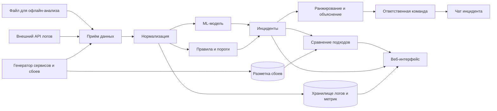

> Архив: версия из log-collector на конец спринта 1 (своя система мониторинга вместо расширения Zabbix). Ссылки внутри ведут на старую структуру. Актуальное — в [docs/](../../README.md).

# Обзор архитектуры

Статус: **черновик**, финальную версию фиксируем в [задаче #2](https://github.com/ITMO-DWS-Green/log-collector/issues/2). Технологии внутри компонентов пока не выбраны — см. [журнал решений](decisions.md).

## Компоненты

| Компонент | Что делает | Требования |
|---|---|---|
| Генератор | Имитирует взаимодействующие сервисы, пишет их логи и метрики, внедряет сбои по сценарию | FR-01, FR-02 |
| Разметка | Хранит правду о каждом внедрённом сбое | FR-02 |
| Приём данных | Принимает поток и файлы, отбрасывает некорректные записи | FR-03 |
| Нормализация | Приводит к единому формату и общей временной шкале | FR-04 |
| Хранилище | Логи и метрики для поиска и графиков | FR-13 |
| Правила и пороги | Обнаружение по правилам и статистическим порогам | FR-05 |
| ML-модель | Обнаружение моделью машинного обучения | FR-06 |
| Инциденты | Объединение срабатываний в инцидент | FR-08 |
| Ранжирование и объяснение | Подозрительные сервисы, отклонившиеся метрики, примеры логов | FR-09, FR-10 |
| Ответственная команда | Поиск команды по справочнику | FR-11 |
| Чат инцидента | Создание чата и отправка описания | FR-12 |
| Сравнение подходов | Метрики качества по разметке | FR-07 |
| Веб-интерфейс | Инциденты, карточка, результаты сравнения | FR-13 |

## Ключевые свойства
- Правила и ML получают **одни и те же** данные — иначе сравнение нечестное.
- Разметка не попадает в обнаружение: её видит только сравнение подходов.
- Поток и файл проходят один и тот же путь после приёма.
