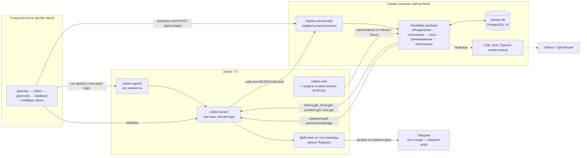

# Спринт 2 — техническая схема

Задача [#98](https://github.com/ITMO-DWS-Green/zabbix-incident-advisor/issues/98). Версия: `main@5ade5a7` (см. [02-delivery.md](02-delivery.md)). Схема и статусы модулей проверены по коду на этом SHA (`compose.yaml`, `BusinessLogicConfig.java`, `infra/setup/e2e_test.py`).

## Схема компонентов

Исходник для слайда. Сплошные стрелки — проверено сквозным тестом CI. Пунктир — есть в коде или в Compose, но на защиту не проверялось.

**Бот команды** (`.github/workflows/meetings.yml`, `telegram.yml`, `ci.yml` → Telegram: напоминания о встречах, протоколы, оповещения CI) — отдельная система на GitHub Actions. Инциденты он не доставляет, и в продуктовую схему не входит.

## Путь данных

1. **test-server → Zabbix.** Четыре сервиса стенда пишут логи в общий том. `zabbix-agent2` отдаёт их как лог-элементы хостов `gateway`, `orders`, `payments`, `database` (#6). Сбой включается плейбуком. Разметка сбоя уходит только в наш сервис (`POST /api/v1/labels`, #39) и в Zabbix не попадает. — *подтверждено* (e2e: `logs_arrived`).
2. **Zabbix → сервис.** Срабатывает триггер, коннектор Zabbix отправляет событие NDJSON на `/zabbix/connector/events` с Bearer-токеном. Если событие потеряно, его подхватывает догон через `problem.get` раз в 5 минут (#41). — *подтверждено* (e2e: подтверждён приём события; догон — unit-тест `IncidentServiceTest` в `./gradlew build`).
3. **Сервис анализа.** Новая проблема добавляется в открытый связанный инцидент (окно 60 с, #40). Через `ADVISOR_ANALYSIS_DELAY=60s` запускается разбор: по API Zabbix берутся история метрик и логи, затем детектор отклонений, извлечение строк логов, ранжирование по графу `depends_on` и объяснение по шаблону (или через LLM). Результат сохраняется в `incident` (JSONB). — *подтверждено* (e2e: источник `database`, каскад в одном инциденте, строки логов в разборе).
4. **Сервис → Zabbix.** Разбор публикуется комментарием к проблеме (`event.acknowledge`). Модуль Incident advisor в интерфейсе Zabbix показывает список и карточку с таймлайном через прокси к `/api/incidents`. — *подтверждено* (e2e: `commented`, страница модуля и прокси открываются).
5. **Zabbix → Telegram.** Действие по тегу команды хоста вызывает вебхук (`infra/setup/telegram_webhook.js`), и разбор из комментария уходит в чат команды (#17). — *подтверждено на заглушке* (e2e: `notified`, `telegram-stub`). Реальный Bot API не проверялся.
6. **Оценка.** `GET /api/evaluation` сверяет разборы с разметкой. — *образец*: совпадение по времени (`TimeOverlapEvaluator`), без метрик и порогов из #2.

## Статус модулей

| Модуль / интерфейс | Реализация на SHA | Статус |
|---|---|---|
| `zabbix-client` | Типизированный JSON-RPC клиент Zabbix 7.0 | рабочая реализация |
| `app`: приём коннектора, конвейер, БД, REST, догон, срок хранения | Spring Boot 3.5, Flyway V1–V4 | рабочая реализация |
| `ServiceGraphProvider` | `TagServiceGraphProvider`: тег `depends_on` | рабочая реализация (только теги) |
| `IncidentMergePolicy` | `GraphWindowMergePolicy` | рабочая реализация |
| `MetricDeviationDetector` | `RobustDeviationDetector`: медиана/MAD, сезонность | рабочая реализация — **задел спринта 3** (#8) |
| `LogEvidenceExtractor` | `PatternLogEvidenceExtractor` | рабочая реализация — **задел спринта 3** (#10) |
| `SuspectRanker` | `GraphEvidenceRanker` | рабочая реализация — **задел спринта 3** (#9) |
| `ExplanationWriter` | `TemplateExplanationWriter`: шаблон, с LLM — пересказ | базовый образец |
| `llm` | stub по умолчанию; OpenAI-совместимый клиент, маскирование, журнал | рабочая реализация, по умолчанию выключена |
| `QualityEvaluator` | `TimeOverlapEvaluator` | базовый образец |
| `CauseSymptomPolicy` | `NoCauseSymptomPolicy` | заглушка (план, #16) |
| `ValueStreamProcessor` | `NoopValueStreamProcessor` | заглушка (план) |
| Модуль Zabbix `incident-advisor` | Список и карточка с таймлайном; страницы точности нет | рабочая реализация, частично |
| Telegram-оповещение | Вебхук + действия, создаваемые `setup` | рабочая реализация, проверена на заглушке |

## Инфраструктура

| | |
|---|---|
| Репозитории | `ITMO-DWS-Green/zabbix-incident-advisor` (сервис, модуль, стенд, docs); `ITMO-DWS-Green/test-server` (стенд, собирается из `#main`) |
| Стек | Java 21, Spring Boot 3.5, Gradle (многомодульный); PHP/JS модуль Zabbix; Python 3.12 (setup, e2e, вебхук-заглушка, бот) |
| Compose | `compose.yaml`: `zabbix-db`, `zabbix-server`, `zabbix-web`, `zabbix-agent2` (Zabbix 7.0), `advisor`, `advisor-db`, `setup` (одноразовая настройка Zabbix через API), `telegram-stub`; profile `stand` — `gateway`, `orders`, `payments`, `database`; опционально `ollama` |
| БД | PostgreSQL 16 ×2: Zabbix и сервис (`incident`, `incident_problem`, `feedback`, `fault_label`, `llm_audit`, настройки срока хранения) |
| CI | `ci.yml`: фильтр изменений → `./gradlew build` → сквозной e2e на Compose; ручная проверка OpenRouter. `bot-tests.yml`, `meetings.yml`, `telegram.yml` — бот команды |
| Ветки / ревью | Работа в ветках, PR в `main` (в основном squash-merge, #53 — merge-коммит); задачи и спринты — Issues и milestones |
| Среда стенда | Локально или на раннере CI одной командой `docker compose --profile stand up -d --build`; отдельного постоянного стенда нет |

## Ограничения схемы

- Реальный Telegram и реальная LLM в CI не участвуют: в CI работают `telegram-stub` и `ADVISOR_LLM_PROVIDER=stub`.
- Токен UI задан в `compose.yaml` только для `advisor`, PHP-модуль его не получает (#82). Поэтому со значением, отличным от `dev-ui-token`, модуль отвечает 401.
- Если Zabbix недоступен в момент публикации комментария, разбор не доставляется (#83), а повторный reanalyze не защищён от гонки (#84).
- Карта связей строится только из тегов `depends_on`.
- Схема описывает `5ade5a7`. Детектор, логи и ранжирование, которые на ней работают, — результат спринта 3, сделанный заранее.
