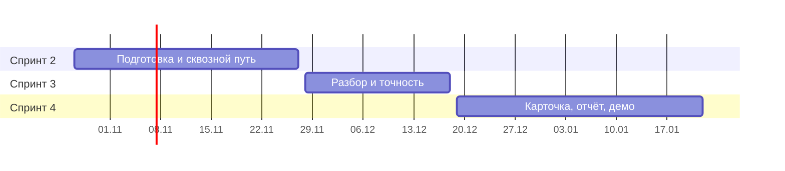

# Дорожная карта

Всего 4 спринта, зачётный — в январе. Спринт 1 позади (своя система мониторинга, см. [архив](../archive/log-collector-sprint-1/README.md)), на расширение остаются три. Задачи — в [Issues](https://github.com/ITMO-DWS-Green/zabbix-incident-advisor/issues), спринты — milestones. Идеи взяты из документа «Расширение Zabbix · 25 идей по приоритету» (26.10.2026); номер идеи — её место в очереди.

**Сценарий защиты:** включили сбой на test-server → сработал триггер в Zabbix → расширение назвало источник и доказало это данными → разбор пришёл в Telegram → показали точность на десятках прогонов.

| Спринт | Срок | Фокус |
|---|---|---|
| 1 | 01.10–23.10 | Команда, требования, аналоги, инфраструктура — сделан в log-collector |
| 2 | до 27.11 | Подготовка и сквозной путь |
| 3 | до 18.12 | Настоящий разбор и точность |
| 4 | до 22.01 | Карточка, отчёт о точности, демо, защита |

## Спринт 2 · до 27.11 · подготовка и сквозной путь
Цель: требования и архитектура согласованы, проблема в Zabbix доходит до Telegram через наш сервис, пусть пока с простым разбором.

Сделано в каркасе: стенд одной командой, клиент API, приём коннектора, карта связей по тегам, базовый разбор и комментарий в Zabbix, БД и приём разметки, модуль интерфейса, карточка с таймлайном ([#44](https://github.com/ITMO-DWS-Green/zabbix-incident-advisor/issues/44)–[#52](https://github.com/ITMO-DWS-Green/zabbix-incident-advisor/issues/52)).

| Задача | Что |
|---|---|
| [#1](https://github.com/ITMO-DWS-Green/zabbix-incident-advisor/issues/1), [#2](https://github.com/ITMO-DWS-Green/zabbix-incident-advisor/issues/2), [#38](https://github.com/ITMO-DWS-Green/zabbix-incident-advisor/issues/38) | Требования, критерии приёмки, НФТ — пересогласовать с заказчиком |
| [#3](https://github.com/ITMO-DWS-Green/zabbix-incident-advisor/issues/3) | Ревью архитектуры каркаса всей командой |
| [#4](https://github.com/ITMO-DWS-Green/zabbix-incident-advisor/issues/4) | Тест-план для TDD |
| [#5](https://github.com/ITMO-DWS-Green/zabbix-incident-advisor/issues/5) | Выбор LLM и правила работы с данными |
| [#6](https://github.com/ITMO-DWS-Green/zabbix-incident-advisor/issues/6) | Логи test-server в Zabbix |
| [#39](https://github.com/ITMO-DWS-Green/zabbix-incident-advisor/issues/39) | test-server отправляет в сервис только разметку |
| [#40](https://github.com/ITMO-DWS-Green/zabbix-incident-advisor/issues/40) | Объединение проблем в инцидент (FR-04) |
| [#41](https://github.com/ITMO-DWS-Green/zabbix-incident-advisor/issues/41) | Догон пропущенных событий |
| [#17](https://github.com/ITMO-DWS-Green/zabbix-incident-advisor/issues/17) | Оповещение с разбором в Telegram (FR-08, идея 9) |

## Спринт 3 · до 18.12 · настоящий разбор
| Задача | Что |
|---|---|
| [#8](https://github.com/ITMO-DWS-Green/zabbix-incident-advisor/issues/8) | Отклонения метрик (FR-05, идея 1) |
| [#9](https://github.com/ITMO-DWS-Green/zabbix-incident-advisor/issues/9) | Ранжирование подозреваемых с учётом карты связей (FR-05, идея 1) |
| [#10](https://github.com/ITMO-DWS-Green/zabbix-incident-advisor/issues/10) | Доказательства из логов (FR-06, идея 2) |
| [#11](https://github.com/ITMO-DWS-Green/zabbix-incident-advisor/issues/11) | Объяснение и полный разбор в комментарии (FR-07, идея 3) |
| [#12](https://github.com/ITMO-DWS-Green/zabbix-incident-advisor/issues/12) | Маскирование и журнал LLM (идея 4) |
| [#15](https://github.com/ITMO-DWS-Green/zabbix-incident-advisor/issues/15) | Точность и сравнение с базовым подходом (FR-09, FR-10, идея 7) |

## Спринт 4 · до 22.01 · интерфейс и защита
| Задача | Что |
|---|---|
| [#13](https://github.com/ITMO-DWS-Green/zabbix-incident-advisor/issues/13) | Карточка: графики, ссылки, логи (FR-11, идея 5) |
| [#14](https://github.com/ITMO-DWS-Green/zabbix-incident-advisor/issues/14) | Карта связей не только из тегов (идея 6) |
| [#42](https://github.com/ITMO-DWS-Green/zabbix-incident-advisor/issues/42) | Страница точности и прогоны всех плейбуков (FR-12) |
| [#43](https://github.com/ITMO-DWS-Green/zabbix-incident-advisor/issues/43) | README и документация к защите |
| [#7](https://github.com/ITMO-DWS-Green/zabbix-incident-advisor/issues/7) | Демо и презентация |

## Если успеем — по порядку (метка `очередь 2`)
| Идея | Задача | Требование |
|---|---|---|
| 8. Причина и симптомы | [#16](https://github.com/ITMO-DWS-Green/zabbix-incident-advisor/issues/16) | FR-15 |
| 13. Оценка разбора инженером | [#21](https://github.com/ITMO-DWS-Green/zabbix-incident-advisor/issues/21) | FR-17 |
| 10. Похожие прошлые инциденты | [#18](https://github.com/ITMO-DWS-Green/zabbix-incident-advisor/issues/18) | FR-16 |
| 14. Выбор LLM, включая локальную | [#22](https://github.com/ITMO-DWS-Green/zabbix-incident-advisor/issues/22) | FR-14 |
| 11. Новые типы ошибок в логах | [#19](https://github.com/ITMO-DWS-Green/zabbix-incident-advisor/issues/19) | — |
| 12. Шумные триггеры | [#20](https://github.com/ITMO-DWS-Green/zabbix-incident-advisor/issues/20) | — |
| 15. Черновик пост-мортема | [#23](https://github.com/ITMO-DWS-Green/zabbix-incident-advisor/issues/23) | — |
| 16. Покрытие мониторинга | [#24](https://github.com/ITMO-DWS-Green/zabbix-incident-advisor/issues/24) | — |

## После защиты
- Метка `очередь 3` — идеи 17–25 ([#25](https://github.com/ITMO-DWS-Green/zabbix-incident-advisor/issues/25)–[#33](https://github.com/ITMO-DWS-Green/zabbix-incident-advisor/issues/33)): тюнинг порогов, норма метрики и ML по группе метрик (FR-13), оценка влияния, группировка, новые триггеры, сводка за смену, подавление ожидаемых отклонений, виджет.
- Метка `эксплуатация` — [#34](https://github.com/ITMO-DWS-Green/zabbix-incident-advisor/issues/34)–[#37](https://github.com/ITMO-DWS-Green/zabbix-incident-advisor/issues/37): установка в чужой Zabbix.
