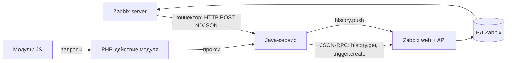

# Расширение Zabbix на Java и JS

Расширение работает рядом с Zabbix 7.0 и не меняет его ядро. Java-сервис получает данные от Zabbix, анализирует их и через API создаёт правила. Интерфейс встраивается в Zabbix модулем на JS.

## Компоненты

| Компонент | Язык | Роль |
|---|---|---|
| Zabbix server | — | Собирает метрики, пересчитывает триггеры, отдаёт поток данных коннекторами |
| Zabbix web + API | PHP | Веб-интерфейс и JSON-RPC API, работает напрямую с БД Zabbix |
| Java-сервис | Java, Spring Boot | Принимает поток, хранит предложения, ходит в API |
| Модуль интерфейса | JS + тонкий PHP | Страница или виджет внутри Zabbix |

## Взаимодействие



| Откуда → куда | Как | Что |
|---|---|---|
| Zabbix server → Java | Коннектор, HTTP POST, построчный JSON | Каждое значение метрики или событие в реальном времени |
| Java → API | JSON-RPC, `/api_jsonrpc.php`, токен API | История, конфигурация, проблемы; создание триггеров |
| Java → Zabbix | `history.push` | Свои значения в элементы Zabbix (например, оценка аномальности) |
| JS → PHP-действие → Java | HTTP внутри Zabbix | Предложения, «принять» и «отклонить» |
| Zabbix → Java (опционально) | Вебхук способа оповещения | События, отобранные правилами действия |

JS ходит в Java через PHP-действие модуля: так работают сессия и права пользователя Zabbix и не нужен CORS.

## Коннектор

- Включить на сервере: `StartConnectors=1` (по умолчанию 0).
- Создать: Administration → General → Connectors или `connector.create`.
- Тип данных: значения метрик (`data_type: 0`) или события (`data_type: 1`).
- Фильтр: по тегам элементов и типам значений.
- Наш сервис должен ответить 200–204, иначе Zabbix повторит отправку (`max_attempts` до 5).

Значение метрики:

```json
{"host":{"host":"gateway","name":"gateway"},"groups":["test-server"],
 "item_tags":[{"tag":"stand","value":"test-server"}],
 "itemid":45678,"name":"Доля 5xx","clock":1761382800,"ns":123456789,"value":0.12,"type":0}
```

Событие:

```json
{"clock":1761382800,"ns":0,"value":1,"eventid":42,"name":"gateway: доля 5xx выше 10%",
 "severity":3,"hosts":[{"host":"gateway","name":"gateway"}],"groups":["test-server"],
 "tags":[{"tag":"service","value":"gateway"}]}
```

Восстановление: `{"clock":...,"ns":...,"value":0,"eventid":43,"p_eventid":42}`.

`type` — тип значения: 0 — дробное, 1 — строка, 2 — лог, 3 — целое, 4 — текст.

## API

Запрос — JSON-RPC 2.0, POST на `/api_jsonrpc.php`, заголовок `Authorization: Bearer <токен>`. Токен — `user.login` или постоянный API-токен (Users → API tokens).

```json
{"jsonrpc":"2.0","method":"history.get","id":1,
 "params":{"itemids":["45678"],"history":0,"time_from":1761296400,"sortfield":"clock","sortorder":"ASC"}}
```

Методы, которые нужны расширению:

| Задача | Методы |
|---|---|
| История для обучения | `history.get`, `trend.get` |
| Что мониторится | `host.get`, `item.get`, `template.get`, `usermacro.get` |
| Существующие правила | `trigger.get` |
| Применить правило | `trigger.create`, `trigger.update` |
| Проблемы и события | `problem.get`, `event.get`, `event.acknowledge` |
| Свои данные в Zabbix | `history.push` |
| Настройка коннектора | `connector.create`, `connector.get` |

Все объекты API 7.0: action, alert, apiinfo, auditlog, authentication, autoregistration, configuration, connector, correlation, dashboard, dcheck, dhost, discoveryrule, drule, dservice, event, graph, graphitem, graphprototype, hanode, history, host, hostgroup, hostinterface, hostprototype, housekeeping, httptest, iconmap, image, item, itemprototype, maintenance, map, mediatype, mfa, module, problem, proxy, proxygroup, regexp, report, role, script, service, settings, sla, task, template, templatedashboard, templategroup, token, trend, trigger, triggerprototype, user, userdirectory, usergroup, usermacro, valuemap.

## Модуль интерфейса

Лежит в `/usr/share/zabbix/modules/<имя>/`, включается в Administration → General → Modules или через `module.create`.

```
modules/rule-advisor/
  manifest.json        id, namespace, действия, подключение JS
  Module.php           добавляет пункт меню
  actions/             контроллеры: страница и прокси в Java
  views/               PHP-шаблон страницы, внутри только контейнер для JS
  assets/js/app.js     весь интерфейс
```

```json
{
  "manifest_version": 2.0,
  "id": "rule-advisor",
  "name": "Rule advisor",
  "namespace": "RuleAdvisor",
  "version": "0.1",
  "actions": {
    "ruleadvisor.view": {"class": "View", "view": "ruleadvisor.view"},
    "ruleadvisor.proxy": {"class": "Proxy"}
  },
  "assets": {"js": ["app.js"]}
}
```

Контроллер наследует `CController` и реализует `checkInput`, `checkPermissions`, `doAction`. Вместо страницы можно сделать виджет дашборда (`"type": "widget"`, своя JS-логика в `js_class`).

## Возможности

Можно:
- получать все значения и события в реальном времени;
- читать историю, тренды и всю конфигурацию;
- создавать и менять триггеры, элементы, шаблоны, теги, макросы, обслуживание, дашборды;
- подтверждать проблемы, менять их важность, комментировать;
- писать свои значения в Zabbix, чтобы штатные графики и триггеры работали и по ним;
- добавлять страницы в меню и виджеты на дашборды.

Нельзя (только на C внутри сервера):
- добавить свою функцию в выражения триггеров;
- менять логику сервера;
- перехватывать данные до записи в историю.

## Тонкие места

- Триггер, созданный через API, начинает работать после того, как сервер перечитает конфигурацию в кэш: до минуты (`CacheUpdateFrequency`).
- Если Java-сервис недоступен, коннектор повторяет отправку, а после исчерпания попыток данные за этот период теряются. Пробелы восполняются через `history.get`.
- Права: токен API Java-сервиса должен иметь доступ на чтение к нужным группам хостов и на запись триггеров.

## Источники

- Исходники Zabbix 7.0: `ui/include/classes/api/` (методы API), `src/zabbix_server/connector/`, `src/libs/zbxcachehistory/` (коннекторы), `ui/include/classes/core/CModule.php`, `ui/include/classes/mvc/CController.php` (модули) — [github.com/zabbix/zabbix](https://github.com/zabbix/zabbix), ветка release/7.0
- [Потоковая выгрузка во внешние системы](https://www.zabbix.com/documentation/7.0/en/manual/config/export/streaming)
- [Протокол экспорта в построчном JSON](https://www.zabbix.com/documentation/7.0/en/manual/appendix/protocols/real_time_export)
- [Модули интерфейса: manifest.json](https://www.zabbix.com/documentation/7.0/en/devel/modules/file_structure/manifest)
- [user.login](https://www.zabbix.com/documentation/7.0/en/manual/api/reference/user/login)
